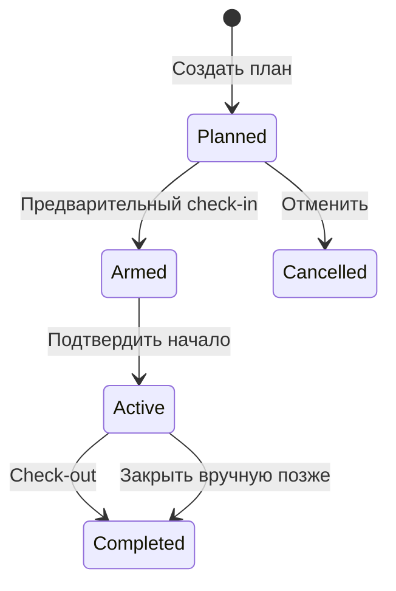

# Функциональный дизайн

Версия: 0.2 (27 октября 2026 года). Это согласуемая спецификация; часть функций ещё находится в разработке.

## Цель и границы

Главная цель — удобный учёт рабочих часов. Один работник ведёт на своём Android телефоне расписание и фактический учёт смен в нескольких проектах. Учёт оплаты необязателен: при создании проекта он выключен и может быть включён для конкретного проекта. Только тогда работник добавляет тарифы и видит денежные суммы. Приложение работает без интернета. Данные можно переносить через резервную копию; автоматическая синхронизация между устройствами в первую версию не входит.

Windows версия запланирована на общей кодовой базе. Первый выпуск для ПК должен открывать отчёты и резервные копии. Полное редактирование смен на ПК требует отдельного решения о синхронизации и конфликтах.

Версия для iPhone также планируется на общей кодовой базе Flutter. До публикации нужно добавить iOS-проект, проверить разрешения и доставку напоминаний, импорт резервных копий, работу с часовыми поясами и сборку на macOS с Xcode. Ручной перенос зашифрованной копии должен работать между Android, iPhone и ПК.

Альтернативный путь для iPhone — PWA, которую работник открывает по ссылке и добавляет на главный экран без регистрации тестового устройства и установки через App Store. Это отдельный вариант развития, а не часть первой локальной версии. Для него нужен SaaS-сервис с Web API: учётная запись, защищённая синхронизация проектов и смен, резервное копирование и разрешение конфликтов между устройствами. Веб-клиент должен сохранять незавершённые действия без сети и отправлять их после восстановления соединения; браузерное хранилище нельзя считать единственной долговременной копией данных.

Напоминания PWA на iPhone следует проектировать через Web Push: пользователь добавляет приложение на главный экран и разрешает уведомления, сервер планирует и отправляет push для check-in, подтверждения начала и check-out. Доставка зависит от сети и системных разрешений, поэтому при открытии приложения просроченные действия также показываются внутри интерфейса. Перед реализацией нужно выбрать модель учётных записей, стоимость и размещение SaaS, правила хранения данных и способ перехода с локальной базы на Web API.

## Термины

| Термин | Значение |
| --- | --- |
| Проект | Место или вид работы, например «Combo BV — сбор ягод». |
| Тариф | Необязательная именованная ставка в проекте с включённым учётом оплаты, например «сбор» и «сортировка». |
| План | Будущая смена с ожидаемыми началом и концом. Не включается в заработок. |
| Предварительный check-in | Выбор проекта и ожидаемого начала до прибытия на работу. Тариф выбирается только для проекта с учётом оплаты. |
| Подтверждение начала | Действие работника после прибытия. Сохраняются время действия и учтённое начало. |
| Check-out | Подтверждение конца работы и учтённого времени окончания. |

## Пользовательский сценарий

1. Работник создаёт проект «Combo BV — сбор ягод». Если ему нужен расчёт заработка, он включает учёт оплаты для проекта и добавляет два тарифа. В проекте без оплаты тарифы не нужны.
2. В календаре работник добавляет смены на неделю. План содержит проект, ожидаемые начало и конец, а тариф может быть выбран заранее или при check-in.
3. В 09:30 работник выбирает сегодняшний план и предварительно отмечает начало на 10:00. Для проекта с оплатой он также выбирает тариф. Можно сделать это накануне вечером. Время выезда из дома (09:00) можно указать в заметке; оно не прибавляется к рабочим часам.
4. На 10:00 назначается местное уведомление «Вы начали работу?». Открытие уведомления приводит на экран подтверждения. На экране видны проект, запланированное начало и, если есть, тариф.
5. Работник подтверждает прибытие. Приложение сохраняет реальное время нажатия отдельно от времени начала, которое войдёт в расчёт. Если подтверждение сделано поздно, работник может выбрать фактическое время начала и указать причину исправления.
6. В конце работы работник делает check-out, вводит неоплачиваемый перерыв при необходимости и видит рассчитанные часы и сумму.
7. При ошибке работник редактирует смену. История исправлений сохраняет исходное и новое время, дату изменения и причину.

## Экраны первой версии

### Сегодня

- Текущая и следующая смена: проект, плановое время, состояние и тариф, если включена оплата.
- Главное действие меняется по состоянию: «Подготовить check-in», «Подтвердить начало», «Завершить смену».
- После check-out показываются учтённые часы и сумма.
- Просроченное подтверждение и незакрытая смена заметно выделяются.

### Календарь

- Неделя по умолчанию, переключение даты, список смен за день.
- Переключатель между текущим списком плана и календарным видом. Выбранный вид запоминается; оба показывают одни и те же смены и позволяют открыть день и смену для редактирования.
- В календарном виде день отмечается количеством смен и их состояниями; отображение остаётся удобным на небольшом экране.
- Добавление плана на несколько дней вперёд и копирование смены на другие дни.
- Пока check-in не сделан, плановую смену можно перенести на другой день или отменить с указанием причины. Отмена сохраняется в истории, чтобы было видно, кто и когда изменил план.
- После check-in перенос и отмена дня через менеджер плана запрещены. Исправления учтённого времени и тарифа выполняются отдельно с обязательной причиной и записью прежних и новых значений.
- План и подтверждённая работа визуально различаются.
- Поддерживаются несколько смен в один день и смена через полночь.

### Проекты и тарифы

- При создании проекта учёт оплаты выключен. Его можно включить или выключить в карточке проекта; изменение влияет на новые check-in, не стирая сохранённые часы и расчёты старых смен.
- История проекта показывает время создания, переключения учёта оплаты и добавления тарифов.
- Создание, переименование и архивирование проекта.
- Несколько именованных тарифов внутри проекта с учётом оплаты; один выбирается для новой смены такого проекта. В проекте без оплаты check-in не требует тарифа.
- Для тарифа: сумма за час, валюта, дата начала действия, необязательное описание.
- Изменение ставки не пересчитывает уже завершённые смены: в смене хранится снимок выбранного тарифа.

### Отчёты

- Периоды: день, календарная неделя с понедельника, месяц, произвольные даты.
- По каждому периоду: учтённые часы и неоплачиваемые перерывы для всех проектов. Суммы и разбивка по тарифам показываются только для смен с включённым расчётом оплаты.
- Незавершённые смены и планы показываются отдельно от заработка.
- Экспорт CSV для таблиц и PDF для просмотра/печати.
- Рядом с «Сохранить CSV» — действие «Отправить CSV». Приложение создаёт файл отчёта за выбранный период и открывает системное меню «Поделиться». Работник выбирает установленное почтовое приложение, при необходимости указывает получателя и сам отправляет письмо с CSV во вложении. Если почтового приложения нет, можно выбрать другое приложение для передачи файла или сохранить CSV обычным способом.
- При передаче CSV приложению предлагаются тема «Отчёт о рабочих часах: {начало периода} — {конец периода}» и текст «Отчёт о рабочих часах за {период} во вложении.» Получатель по умолчанию пустой. Перед отправкой пользователь может изменить тему, текст и получателя. Некоторые приложения из меню «Поделиться» могут не принять предложенную тему или текст; наличие CSV-вложения важнее предварительного заполнения письма.
- Техническое решение для Android и iPhone: передавать CSV как файл через системный share sheet (`ACTION_SEND` на Android; в Flutter можно использовать пакет для системного обмена файлами). Обычная ссылка `mailto:` не подходит для вложения CSV: она создаёт черновик письма без файла. На Windows использовать системный обмен файлом, если он доступен; иначе предложить сохранить CSV и прикрепить его вручную в почтовой программе. Приложение само не отправляет письмо через сервер и не запрашивает пароль от почты.

### Резервные копии и настройки

- Ручное создание зашифрованной резервной копии и передача файла через системное меню Android в выбранное облако или на ПК.
- Восстановление из файла с предварительным просмотром: дата копии, количество проектов и смен.
- Подтверждение перед заменой локальных данных; исходная база сохраняется до успешной проверки импорта.
- Параметры: язык, валюта по умолчанию, первый день недели, напоминания и периодичность предложения сделать копию.

### Языки и оформление

- Интерфейс: английский, русский, украинский, польский, испанский, турецкий и узбекский (сначала латиница). По умолчанию используется язык системы, если он поддерживается; иначе английский. Работник может выбрать язык вручную и вернуться к системному.
- Тексты интерфейса, ошибок, напоминаний и отчётов локализуются вместе; введённые пользователем названия проектов, заметки и причины изменений остаются в исходном виде.
- У каждого состояния смены есть узнаваемая иконка, цвет и текст: запланирована, предварительный check-in, работа идёт, завершена, отменена. Цвет не является единственным признаком состояния.
- Во время активной смены допустима ненавязчивая анимация. На экране «Сегодня» показывается компактная шкала с временем до планового начала или конца и текстовым обратным отсчётом. Шкала показывает ориентир по плану и не меняет учтённые часы автоматически; при неизвестном плановом конце отсчёт до конца не показывается.

### О приложении

- Имя создателя, версия установленного приложения, назначение и ссылка на публичный исходный код доступны из главного меню приложения. Служебная информация Flutter и текст лицензии в окне не показываются; лицензия остаётся в публичном репозитории.

## Состояния смены

- `Planned`: ожидаемая смена. В заработке не учитывается.
- `Armed`: предварительный check-in сделан, уведомление назначено; начало работы ещё не подтверждено.
- `Active`: начало подтверждено, конец отсутствует. В итоговом заработке не учитывается до завершения.
- `Completed`: есть оба учтённых времени и рассчитанная длительность. Тариф и денежный итог есть только у смен с учётом оплаты.
- `Cancelled`: исключена из итогов, остаётся видимой в плане и истории; отмена разрешена только до check-in.

Предварительный check-in без заранее созданного плана создаёт смену сразу в состоянии `Armed`. Подтвердить начало можно и без предварительного check-in: проект и, при учёте оплаты, тариф выбираются на экране подтверждения.

## Правила времени и денег

1. Плановое начало, время предварительного check-in, время подтверждения, учтённое начало и учтённый конец хранятся отдельно.
2. По умолчанию при подтверждении предлагается плановое начало, если работник указывает, что пришёл вовремя. При опоздании выбирается фактическое начало. Окончательное поведение требуется согласовать.
3. Продолжительность = `учтённый конец − учтённое начало − неоплачиваемые перерывы`. Отрицательное значение запрещено.
4. Если для смены выбран тариф, деньги = `учтённые минуты × ставка за час / 60`. В расчёте используются целые минуты и десятичная арифметика; округление до минимальной денежной единицы происходит при отображении и итоговом экспорте. Для смены без тарифа денежные поля остаются пустыми, а не показывают нулевую зарплату.
5. Если ставка меняется внутри смены, работа разбивается на два участка с разными тарифами. Это расширение после первой версии; в первой версии один тариф на смену.
6. Время хранится как момент UTC вместе с часовым поясом устройства на момент записи. Отчёты группируются по местной дате начала смены. Смена через полночь остаётся одной записью; распределение по календарным дням нужно согласовать для отчётов.
7. Пересекающиеся активные смены требуют подтверждения и предупреждения, чтобы не удвоить часы.

### Отклонения от плана и проверки

- Опоздание, ранний приход и ранний уход показываются рядом с соответствующим временем как отклонения от плана. Отклонение до 20 минут включительно считается обычной ситуацией: лёгкое предупреждение, без блокировки сохранения и без автоматического изменения учтённого времени.
- При отклонении больше 20 минут предупреждение заметнее; приложение предлагает проверить время и указать причину, но позволяет сохранить фактическую запись. Порог 20 минут — начальное значение, которое можно будет сделать настраиваемым.
- Невозможные или противоречивые данные — конец раньше начала, перерыв длиннее смены, наложение учтённых интервалов разных смен — показываются отдельным объяснением: какие смены и времена конфликтуют и что нужно исправить. Такие записи не сохраняются до исправления; предупреждение о наложении должно учитывать смены через полночь.
- Проверки не подменяют фактическое время плановым. Исправления после сохранения отражаются в истории изменений.

## Напоминания

- Для запланированной смены на время начала назначается напоминание сделать check-in.
- После предварительного check-in это напоминание заменяется напоминанием подтвердить начало.
- После подтверждения начала на ожидаемый конец назначается напоминание сделать check-out. После завершения смены оно отменяется.

- Напоминание о подтверждении начала назначается на плановое начало. Если уведомления запрещены системой или Android задерживает доставку, приложение показывает просроченное подтверждение при следующем открытии.
- После неподтверждённого начала повторное напоминание предлагается через настраиваемый интервал; уведомление удаляется при подтверждении смены.
- Незавершённая смена может напоминать о check-out после планового конца, если он задан.
- Для точного срабатывания на Android могут потребоваться отдельные разрешения; интерфейс объяснит это при включении функции.

## Конфиденциальность и перенос

- Рабочие записи находятся локально на устройстве. Учётная запись и сервер для первой версии не нужны.
- Резервная копия имеет версию формата, контроль целостности и шифрование паролем, который не хранится в файле.
- Приложение не получает доступ ко всему облачному хранилищу: работник сам выбирает, куда отправить готовый файл.
- Публичный исходный код не содержит реальные записи, пароли, ключи подписи APK или резервные копии.

## Критерии готовности первой версии

- Сценарий 09:30 → запланированное 10:00 → напоминание → подтверждение → check-out работает без сети.
- Проект без оплаты позволяет пройти весь цикл check-in → подтверждение → check-out и получить отчёт по часам без тарифа и денежных сумм.
- Два тарифа проекта с учётом оплаты доступны при check-in, выбранная ставка правильно отражается в отчёте.
- План на следующую неделю можно создать и изменить; планы не попадают в заработок.
- Ручное исправление времени оставляет запись в истории.
- Отчёты за день, неделю, месяц и выбранный период совпадают с суммой завершённых смен.
- Действие «Отправить CSV» открывает системное меню передачи с готовым CSV-файлом за выбранный период. Отмена меню не удаляет отчёт и не показывает ошибку; письмо не отправляется автоматически.
- Если выбранное почтовое приложение поддерживает тему и текст из системного меню передачи, черновик содержит тему с периодом и короткое описание, а CSV остаётся вложением. Пользователь проверяет письмо перед отправкой.
- Резервная копия восстанавливает проекты, тарифы, планы, смены и историю на другом Android.

## Вопросы для согласования

1. При подтверждении в 10:05 после планового начала 10:00 считать работу с 10:00, с 10:05 или предложить выбор?
2. Какой облачный сервис предпочтителен: Google Drive, OneDrive или любой через экспорт файла?
3. Какая валюта и нужны ли доплаты за вечер, выходные и праздники?
4. Нужно ли учитывать дорогу до работы отдельным оплачиваемым тарифом?
5. На ПК нужны только отчёты и копии или полное редактирование смен?
